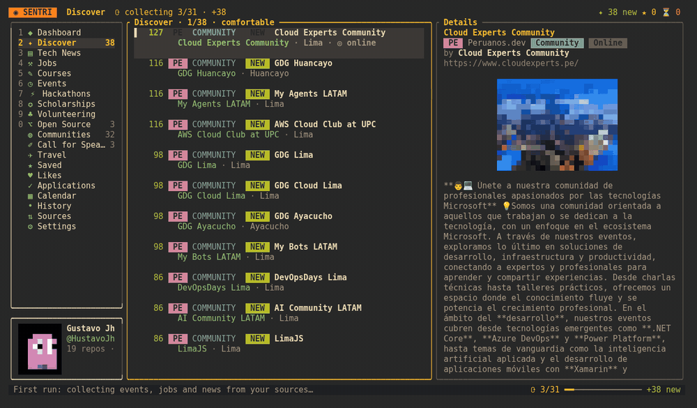
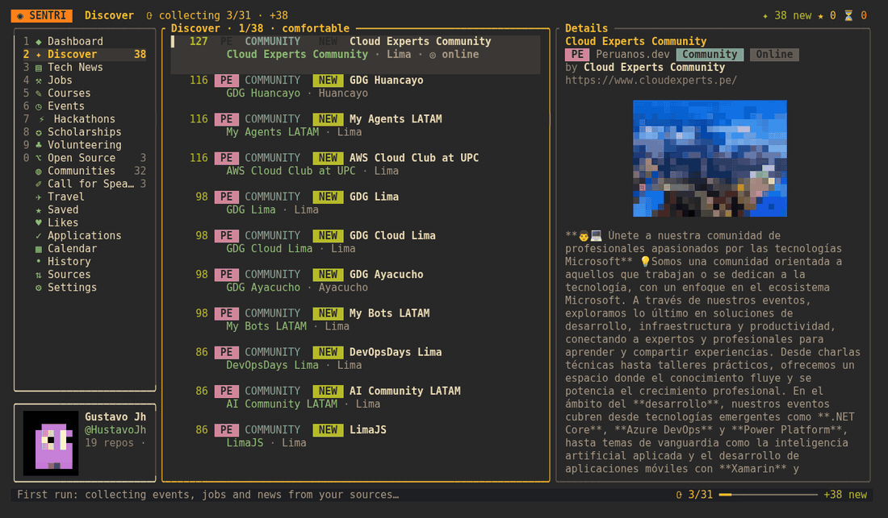
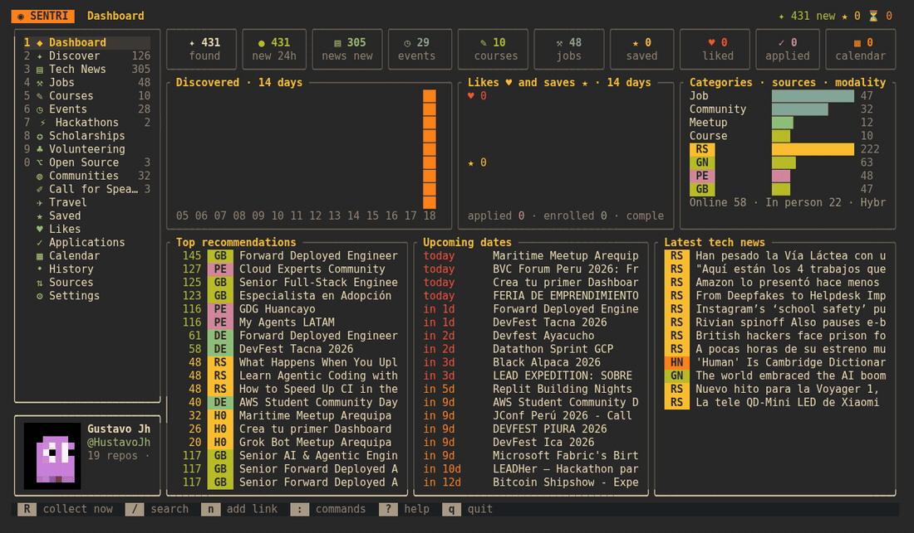
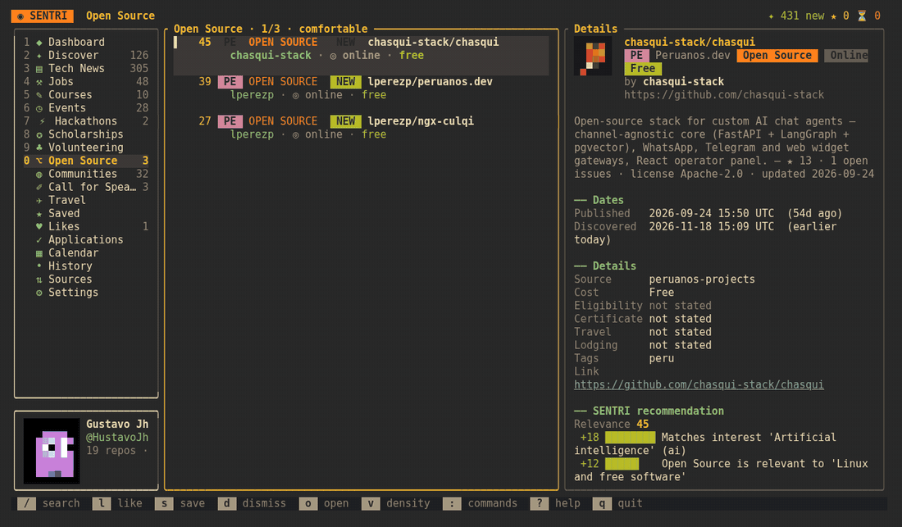
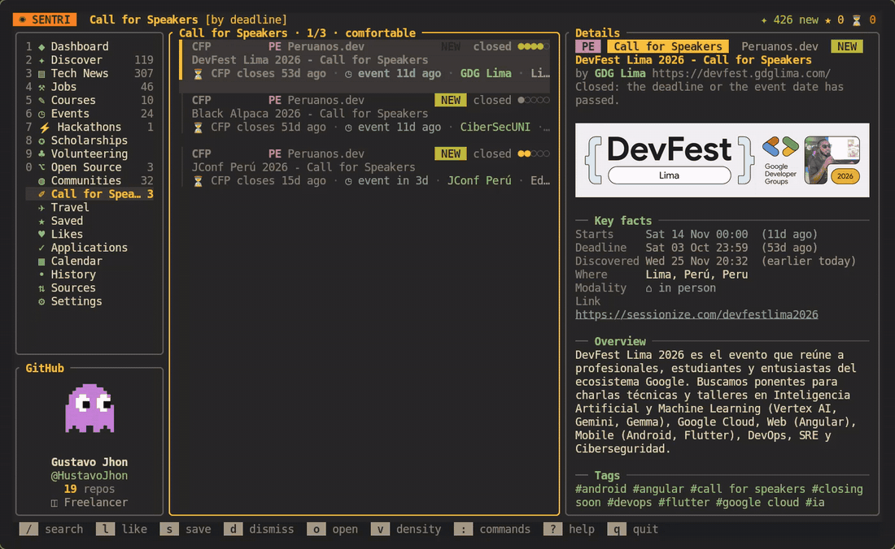
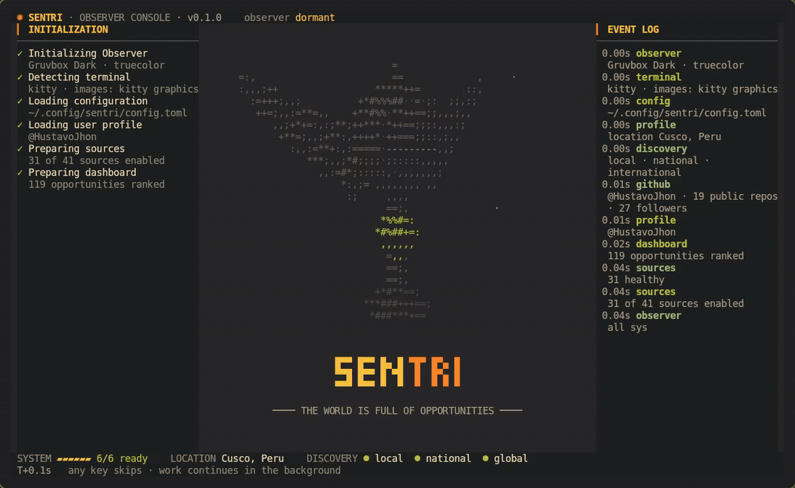
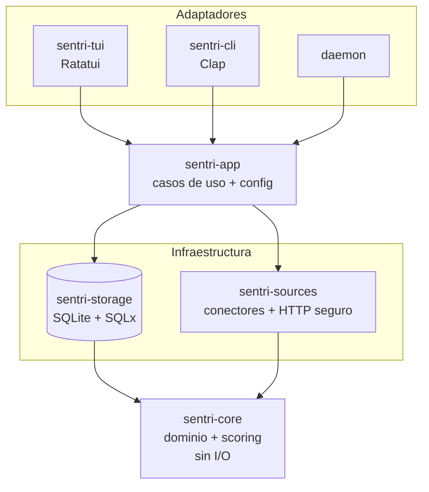

<div align="center">

# SENTRI

### Tu radar personal de oportunidades, en la terminal

[English](README.md) · **Español**

**SENTRI** reúne becas, hackathons, cursos, empleos, voluntariados,
fellowships, convocatorias, eventos, comunidades y proyectos open source en un
solo feed, los puntúa según tus intereses y te deja decidir qué hacer con cada
uno.

[](https://github.com/HustavoJhon/sentri/actions/workflows/ci.yml)
[](https://www.rust-lang.org/)
[](https://doc.rust-lang.org/edition-guide/rust-2024/index.html)
[](https://www.sqlite.org/)
[](https://ratatui.rs/)
[](docs/roadmap.md)

[Qué es](#qué-es-sentri) · [Características](#características) ·
[Instalación](#instalación) · [Uso](#uso) ·
[Imágenes en la terminal](#imágenes-en-la-terminal) ·
[Arquitectura](#arquitectura) · [Uso de IA](#uso-de-ia) ·
[Contribuir](#comentarios-y-contribuciones)

</div>

> La versión en inglés ([README.md](README.md)) es la referencia. Si las dos
> versiones no coinciden, vale la inglesa.



<p align="center">
  <sub>Grabado en kitty, así que las imágenes usan el protocolo gráfico de kitty · Gruvbox Dark · usable por SSH sin Nerd Fonts</sub>
</p>

---

## Qué es SENTRI

Las buenas oportunidades están repartidas entre decenas de sitios: portales de
becas, blogs, GitHub, Hacker News, calendarios de comunidades, bolsas de
empleo y directorios de eventos. Casi siempre llegan tarde o se pierden.

SENTRI es un **radar personal** para ese problema. Recopila, normaliza y
deduplica lo que te importa, le asigna a cada elemento una **puntuación
explicable** y lo muestra todo en una interfaz de terminal rápida, privada y
sin distracciones.

**Para quién es:** estudiantes, desarrolladores y miembros de comunidades tech
que quieren seguir oportunidades sin revisar veinte páginas. Está pensado para
el ecosistema tech de Perú y Latinoamérica (Peruanos.dev, capítulos de GDG,
Get on Board, hack0.dev), y funciona igual de bien en cualquier lugar donde
puedas apuntarlo a feeds y fuentes públicas.

**Qué encuentra:** becas, fellowships, intercambios, hackathons y concursos,
cursos y capacitaciones, empleos y prácticas, voluntariados, convocatorias,
conferencias, meetups y talleres, Call for Speakers, comunidades, proyectos
open source y noticias de tecnología.

No es otro lector RSS ni un buscador de empleo. Es una bandeja de entrada
personal para decidir **qué oportunidad merece tu tiempo**.

### Lo que lo hace diferente

- **Relevancia explicable.** Cada recomendación muestra *por qué* está donde
  está: intereses que coinciden, ciudad, país, modalidad, viaje, deadline y la
  afinidad que SENTRI aprende de tus likes y guardados.
- **Fuentes independientes.** Un conector que falla nunca detiene a los demás;
  su error queda registrado y la recopilación sigue.
- **Terminal first.** Una interfaz en Rust + Ratatui que funciona por SSH,
  incluso desde el móvil, sin Nerd Fonts. Las imágenes usan gráficos Kitty o
  Sixel cuando la terminal los soporta, y medios bloques de color en el resto.
- **Local first.** Tus datos viven en una base SQLite embebida en tu máquina:
  sin cuentas ni servicios en la nube. Los archivos se crean con permisos solo
  para tu usuario.
- **El contenido externo no es de confianza.** El cliente HTTP bloquea SSRF,
  aplica límites de tamaño y tiempo, sanea el texto antes de que llegue a la
  terminal y lee los secretos solo de variables de entorno.

## En acción

| Primer arranque | Dashboard |
|---|---|
|  |  |
| **Ecosistema peruano** | **Calendario** |
|  |  |

## Características

| | |
|---|---|
| **Feed unificado** | Oportunidades y noticias en un solo lugar, con filtros, búsqueda y orden por relevancia, fecha o deadline. |
| **Onboarding personalizado** | En la primera ejecución, el ward Observer despierta mientras SENTRI se inicia y un breve asistente pregunta tu usuario de GitHub (opcional), país, ciudad, zona horaria, dónde buscar y qué te interesa. Todo es opcional, se guarda al avanzar y se edita después. |
| **Scoring por reglas** | Intereses, categorías, ciudad, país, modalidad, elegibilidad, cursos gratuitos, certificados, premios, viaje y deadlines. Sin cajas negras. |
| **Afinidad aprendida** | Likes, guardados, descartes y postulaciones ajustan las recomendaciones por categoría, etiqueta y tipo de oportunidad. |
| **Interacciones claras** | Like, guardado, descarte, interesante, postulado, inscrito y completado, con historial append-only. |
| **Añadir cualquier enlace** | `sentri add URL` detecta la plataforma, lee metadatos públicos (Open Graph / JSON-LD) y guarda la URL aunque la página bloquee la lectura. |
| **Conectores** | RSS/Atom (incluidos los feeds de Google News, Mastodon, Bluesky y YouTube), iCalendar (Luma, Meetup), GitHub (repositorios y *good first issues*), Hacker News, GDG, Devpost, Kaggle, Peruanos.dev, hack0.dev, dev.events y Get on Board. |
| **Cards por tipo** | Los empleos muestran salario, modalidad y habilidades; los eventos, fecha, organizador y lugar; las comunidades, ciudad y enlaces; las noticias, tema, autor y clasificación. Lo que muestran las cards es configurable. |
| **Detalles completos** | Descripción con sus párrafos y listas, datos clave, imagen (con visor a pantalla completa), autor, notas, historial de cambios y campos personalizados. |
| **Dashboard configurable** | Elige qué widgets y métricas aparecen, su orden, y un diseño detallado o compacto. |
| **Calendario** | Vistas de mes, semana, día y agenda; programa las fechas de una oportunidad sin inscribirte en nada. |
| **Configuración declarativa** | Perfil, intereses, pesos del scoring y fuentes en un `config.toml` comentado, también editable desde la TUI. Añadir un interés no requiere código. |
| **Daemon en segundo plano** | Recopilación periódica con bloqueo de instancia única, recuperación tras caídas y unidad de systemd. |
| **Seguro por defecto** | Se bloquean IPs privadas, de loopback y de metadatos cloud; se limitan redirecciones, tipos de contenido y tamaños; el texto se sanea para la terminal. |
| **Un solo binario** | SQLite va incluido: no hay servidor, servicio externo ni base de datos que instalar. |

## Instalación

### Requisitos

- **Rust stable 1.89+** (edición 2024).
- **Linux** (desarrollado y probado en un escritorio Linux; también funciona por SSH).
- Nada más: SQLite se compila dentro del binario (`sqlx` con `sqlite-bundled`).

### Desde el código

```sh
git clone https://github.com/HustavoJhon/sentri.git
cd sentri
cargo install --path crates/sentri-cli
```

También puedes ejecutarlo sin instalar:

```sh
cargo run -p sentri-cli --          # abre la TUI
cargo run -p sentri-cli -- --help   # lista los comandos
```

### Primer arranque

```sh
sentri               # primera vez: despierta el Observer y luego un asistente
```



Mientras SENTRI se inicia se abre una consola de observación: el Observer, un
ward original en 3D hecho con caracteres de terminal (sombreado por
profundidad, sin imágenes), despierta, se ilumina y gira 360° con anillos de
energía, un radar y partículas. A su alrededor, los pasos reales de arranque
(izquierda), un registro de lo que de verdad ocurrió (derecha) y una barra con
progreso, ubicación y descubrimiento local · national · global. El ojo se abre
por etapas pero nunca antes que el progreso real. Dura unos 7 s
(`[onboarding] startup_style = "brief"`: ~1,5 s), cualquier tecla lo salta y el
dashboard se carga detrás desde el primer instante. En la primera ejecución, un asistente de seis páginas
pregunta:

1. tu **usuario de GitHub** (opcional; solo perfil público, nunca un token);
2. tu **ubicación**: código de país ISO, ciudad, región y zona horaria
   (detectada del sistema);
3. **dónde buscar**: local, nacional, internacional, remoto, híbrido o
   presencial;
4. tus **intereses**: eventos, cursos, hackathons, becas, competencias,
   comunidades, open source, CFPs, noticias tech, empleos.

Cada página se guarda al continuar, así que si sales a mitad retomas ahí la
próxima vez. Las configuraciones existentes nunca pasan por el asistente;
repítelo con `O` en Settings o con `sentri onboarding`. La animación se
desactiva con `[onboarding] startup_animation = false`, se vuelve estática con
`SENTRI_NO_ANIMATION` y usa ASCII si la terminal no tiene Unicode. Detalle en
[docs/onboarding.md](docs/onboarding.md).

Con la base vacía, la TUI empieza a recopilar enseguida y llena cada sección a
medida que responden las fuentes. `sentri collect` hace lo mismo desde la línea
de comandos, y `sentri config init` escribe la configuración comentada (nunca
sobrescribe).

## Uso

### Línea de comandos

```sh
sentri                                  # abre la TUI
sentri add https://example.com/evento   # añade un enlace con sus metadatos
sentri feed --view jobs --free --upcoming
sentri search rust --category open_source
sentri show 42                          # detalles y explicación del score
sentri like 42                          # alterna like
sentri save 42
sentri mark 42 applied
sentri schedule 42                      # añade sus fechas al calendario
sentri calendar --days 60
sentri collect --source hn-front-page
sentri sources
sentri status
sentri terminal                         # explica cómo dibuja imágenes esta terminal
sentri onboarding                       # repite el asistente en el próximo arranque
sentri daemon --interval 120            # recopilación continua
sentri backup ~/backups/sentri.db
```

<details>
<summary><b>Comandos principales</b></summary>

| Comando | Qué hace |
|---|---|
| `sentri` | Abre la TUI. |
| `sentri add URL` | Añade un enlace y lee sus metadatos públicos. |
| `sentri edit ID` | Corrige o completa campos; `--set campo=valor` y `--reset campo`. |
| `sentri feed --view …` | Feed filtrado por sección: `discover`, `news`, `jobs`, `courses`, `events`, `hackathons`, `scholarships`, `volunteering`, `open-source`, `travel`… |
| `sentri search …` | Busca por palabras con los mismos filtros del feed. |
| `sentri show ID` | Detalles y explicación de la relevancia. |
| `sentri like/save/dismiss ID` | Alterna una interacción. |
| `sentri mark/unmark ID FLAG` | Estado: `applied`, `enrolled`, `completed`, `interesting`… |
| `sentri history` | Acciones recientes. |
| `sentri calendar` | Entradas del calendario y oportunidades con fecha. |
| `sentri schedule ID` | Añade las fechas de una oportunidad al calendario. |
| `sentri collect` | Recopila ahora de las fuentes habilitadas. |
| `sentri daemon` | Recopila en segundo plano (pensado para systemd). |
| `sentri terminal` | Muestra la terminal detectada, el protocolo gráfico, cómo se dibujan las imágenes y por qué. |
| `sentri onboarding` | Vuelve a abrir el asistente en el próximo arranque de la TUI (conserva tus respuestas). |
| `sentri config init/path/check` | Gestiona y valida la configuración. |
| `sentri backup FILE` | Copia consistente de la base de datos. |

</details>

### Atajos de la TUI

| Tecla | Acción |
|---|---|
| `j` `k` `↓` `↑` | Mover |
| `Enter` | Abrir detalles (queda en el historial) |
| `Tab` `⇧Tab` `[` `]` | Cambiar de sección |
| `1`…`9` `0` | Saltar a una sección |
| `l` `s` `d` `i` | Like · guardar · descartar · interesante |
| `p` `e` `c` | Postulado · inscrito · completado |
| `a` | Añadir al calendario |
| `o` | Abrir el enlace original |
| `z` | Ver la imagen a pantalla completa (`Esc` cierra) |
| `n` | Añadir un enlace |
| `/` | Buscar |
| `:` `Ctrl-p` | Paleta de comandos |
| `S` | Cambiar orden: relevancia → recientes → deadline |
| `E` | Editar todos los campos y tus notas |
| `v` | Densidad de las cards |
| `R` | Recopilar ahora |
| `?` | Ayuda |
| `q` `Ctrl-c` | Salir |

Los atajos se pueden cambiar en **Settings › Shortcuts** o en `[keys]`. La TUI
se adapta al ancho: tres paneles desde 110 columnas, dos desde 80, una barra
estrecha de secciones desde 60 y solo el feed en pantallas más pequeñas.
Ratón: rueda para desplazarse, clic para seleccionar y segundo clic para abrir
detalles. Ver [docs/tui.md](docs/tui.md).

## Configuración

| Qué | Ruta por defecto (Linux) |
|---|---|
| Configuración | `~/.config/sentri/config.toml` (o `$SENTRI_CONFIG`) |
| Base de datos | `~/.local/share/sentri/sentri.db` |
| Caché de imágenes | `~/.cache/sentri/images` |
| Secretos | Variables de entorno; la configuración solo guarda su **nombre** (`token_env`) |

Un interés se declara sin tocar código:

```toml
[[profile.interests]]
name = "Artificial intelligence"
keywords = ["ai", "ia", "machine learning", "llm", "deep learning"]
categories = ["hackathon", "fellowship"]
priority = "high"          # low ×1 · medium ×2 · high ×3
```

El asistente rellena tu perfil; también puedes editarlo a mano (todo es
opcional):

```toml
[profile]
country_code = "PE"            # ISO 3166-1 alfa-2; añade "Peru" y "Perú" a la comparación
home_city = "Tu ciudad"
region = "Tu región"
timezone = "America/Lima"      # vacío: la zona del sistema
preferred_modalities = ["online", "hybrid", "in_person"]

[discovery]
local = true                   # bonificación para tu ciudad
national = true                # bonificación para tu país
international = true           # bonificación para lo de fuera abierto a ti
topics = ["hackathons", "open_source", "jobs"]

[github]
username = "tu-usuario-de-github"  # perfil público, avatar y lenguajes; sin token
```

La personalización solo reordena el feed: nada se oculta, lo internacional y
lo remoto siguen visibles y cada bonificación muestra su razón ("Takes place
in your city", "Matches your interest in Hackathons", "Matches interest 'your
GitHub languages: rust, go'").

Los pesos del scoring (`home_city`, `travel`, `deadline_soon`,
`not_eligible`, `avoid_keyword`…) son configurables y cada recomendación se
puede explicar desde la TUI o con `sentri show`. Los widgets del dashboard y
el contenido de las cards se configuran en `[dashboard]` y `[cards]`. Todo se
puede cambiar también desde **Settings** en la TUI, que conserva tus
comentarios y hace una copia de seguridad antes de escribir. Ver
[docs/configuration.md](docs/configuration.md).

## Imágenes en la terminal

SENTRI muestra imágenes (afiches de eventos, logos, tu avatar de GitHub) con
píxeles reales cuando la terminal soporta un protocolo gráfico, y con medios
bloques de color (`▀`, dos píxeles por celda) en el resto. Deja
`images = "auto"` (el valor por defecto): pregunta a la terminal qué soporta
al abrir la TUI. El dibujo usa
[`ratatui-image`](https://github.com/ratatui/ratatui-image) 11.1.

Ejecuta `sentri terminal` para ver qué detectó SENTRI en tu terminal, con qué
está dibujando y por qué.

| Terminal | Protocolo | Qué se probó en una terminal real |
|---|---|---|
| foot 1.28 | Sixel | ✅ Detección, imagen de detalles y avatar dibujados en Sixel, arranque sin pulsar ninguna tecla |
| Alacritty 0.17 | ninguno (Alacritty no soporta ni gráficos Kitty ni Sixel) | ✅ Detección y respaldo con medios bloques |
| tmux 3.8 dentro de foot, `allow-passthrough on` | Sixel se detecta pero **no se usa**: tmux no puede colocar bien las imágenes Sixel, así que `auto` usa medios bloques | ✅ Las imágenes grandes y el visor a pantalla completa se dibujaron bien, pero las pequeñas aparecieron en el lugar equivocado; se comprobaron el respaldo, la navegación y la salida limpia |
| tmux sin `allow-passthrough` | ninguno: los gráficos no llegan a la terminal | ✅ Medios bloques, sin teclas perdidas al arrancar |
| kitty 0.49 | protocolo gráfico de Kitty (kitty no tiene Sixel) | ✅ Detección, imagen de detalles, avatar, visor a pantalla completa, navegación, redibujado al cambiar el tamaño, `sentri terminal` |
| tmux 3.8 dentro de kitty, `allow-passthrough on` | protocolo gráfico de Kitty, con marcadores Unicode | ✅ Detección, imágenes en su sitio, navegación, visor a pantalla completa, salida limpia sin imágenes residuales |
| WezTerm, Ghostty, iTerm2, Konsole, Windows Terminal | depende de la terminal | ⏳ Sin probar; `ratatui-image` soporta imágenes Kitty, Sixel e iTerm2 |

Notas:

- El cambio de tamaño se comprobó en kitty con imágenes en pantalla (129×66 →
  68×39 → 150×76 columnas: las imágenes se redibujan al nuevo tamaño) y en tmux
  con medios bloques. Cambiar el tamaño con imágenes Sixel en pantalla aún no
  se ha comprobado.
- Dentro de tmux, las imágenes Kitty usan marcadores Unicode que tmux mantiene
  en su sitio; necesitan `set -g allow-passthrough on` en `~/.tmux.conf`.
  SENTRI nunca cambia tu configuración de tmux.
- **¿Ves imágenes pixeladas en kitty o foot?** Revisa `images` en tu
  `config.toml`: los archivos de configuración antiguos tienen
  `images = "halfblock"`, que nunca pregunta a la terminal. SENTRI lo avisa al
  abrir, en Settings y en `sentri terminal`; pon `images = "auto"` y reinicia.
- `images = "kitty"`, `"sixel"` o `"iterm2"` fuerza un protocolo (por ejemplo
  Sixel dentro de tmux, bajo tu responsabilidad). `"halfblock"`, `"ascii"` y
  `"off"` nunca usan uno.
- Detalles: [docs/configuration.md](docs/configuration.md#imágenes).

## Arquitectura

SENTRI es un **monolito modular** en un workspace de Cargo. No hay
microservicios: la TUI, la CLI y el daemon son adaptadores que llaman a los
mismos casos de uso.



| Crate | Responsabilidad |
|---|---|
| `sentri-core` | Modelos de dominio, normalización y deduplicación de URLs, intereses, scoring por reglas. **Sin I/O.** |
| `sentri-storage` | SQLite, migraciones versionadas y repositorios. |
| `sentri-sources` | Trait `Connector`, conectores, cliente HTTP seguro (anti-SSRF) y extracción de metadatos. |
| `sentri-app` | Configuración TOML y casos de uso: recopilar, añadir enlaces, interactuar, consultar el feed y el calendario. |
| `sentri-tui` | Interfaz Ratatui. Solo habla con `sentri-app`. |
| `sentri-cli` | El binario `sentri` (Clap): despacha subcomandos y abre la TUI. |

Reglas clave: `sentri-core` no hace I/O; los adaptadores nunca ejecutan SQL ni
HTTP directamente; el contenido externo se valida, se trunca y nunca se
ejecuta. Ver [docs/architecture.md](docs/architecture.md) y las
[decisiones de arquitectura](docs/adr/).

## Seguridad y privacidad

- **Anti-SSRF** en cada petición: solo `http`/`https`, solo IPs públicas, DNS
  rebinding filtrado, redirecciones revalidadas y proxies del sistema
  ignorados.
- **Límites** de tiempo, tamaño, redirecciones y `Content-Type`, aplicados
  durante la descarga.
- **Saneamiento** de caracteres de control y bidireccionales para evitar la
  inyección de ANSI en la terminal. Las descripciones conservan sus párrafos y
  listas, pero nunca se dibuja HTML.
- **Secretos** nunca en el repositorio ni en `config.toml`: solo en variables
  de entorno (`token_env`).
- **Datos personales** con permisos `0600` (base, WAL y copias de seguridad)
  en un directorio `0700`.
- **Sin scraping** de plataformas restringidas ni cookies de cuentas
  personales.
- **Perfil en pantalla:** las direcciones IP que aparezcan en los campos de tu
  perfil público de GitHub nunca se muestran.
- **Los datos del onboarding se quedan en tu equipo:** ubicación, zona
  horaria, ámbitos e intereses viven solo en `config.toml`. Solo el usuario de
  GitHub sale del equipo, en peticiones anónimas a la API pública de GitHub;
  los logs nunca incluyen tu perfil. Ver [docs/privacy.md](docs/privacy.md).

Ver [docs/security.md](docs/security.md).

## Uso de IA

SENTRI se construyó con un **uso intensivo de asistentes de programación con
IA** (Claude Code y OpenCode). El mantenedor escribió las especificaciones,
revisó los cambios y es responsable del resultado. **SENTRI no usa IA al
ejecutarse** ni envía tus datos a servicios de IA: las recomendaciones salen
de reglas explícitas y explicables. Declaración completa (en inglés):
[AI_USAGE.md](AI_USAGE.md).

## Roadmap

| Fase | Contenido | Estado |
|---|---|---|
| 0–4 | Workspace, modelos, SQLite, búsqueda, interacciones, TUI | Hecho |
| 5 | Conectores (RSS/Atom, GitHub, Hacker News, iCalendar, ecosistema peruano, Get on Board…) | En curso |
| 6 | Intereses, scoring, explicaciones y personalización | Perfil del onboarding, ámbitos y lenguajes de GitHub hechos |
| 7 | Eventos y Google Calendar (OAuth2) | Calendario local hecho; Google sin conectar |
| 8–10 | Cursos, empleos, perfil profesional y ayuda con inscripciones | Pendiente |
| 11 | Daemon, systemd, reintentos y supervisión | Base hecha |
| 12–13 | Acceso remoto, VPS, API Axum y PWA | Pendiente |

Detalles y próximos pasos: [docs/roadmap.md](docs/roadmap.md).

## Desarrollo

```sh
./scripts/check.sh   # fmt + clippy (-D warnings) + tests
```

El mismo script corre en GitHub Actions para `main` y `dev`. La documentación
técnica vive en [`docs/`](docs/) y por ahora está escrita en español:

| Documento | Contenido |
|---|---|
| [Arquitectura](docs/architecture.md) | Capas, crates y flujo de datos |
| [Configuración](docs/configuration.md) | Perfil, intereses, scoring, fuentes, dashboard, cards e imágenes |
| [Fuentes](docs/sources.md) | Viabilidad, políticas y orden de implementación |
| [Seguridad](docs/security.md) | Anti-SSRF, secretos y datos personales |
| [TUI](docs/tui.md) | Distribución, atajos y secciones |
| [Daemon](docs/daemon.md) | systemd, garantías y despliegue en VPS |
| [Base de datos](docs/database.md) | Modelo, migraciones, copias de seguridad y permisos |
| [Edición](docs/editing.md) | Datos detectados frente a correcciones manuales |
| [Calendario](docs/calendar.md) | Vistas, entradas y Google Calendar |
| [Roadmap](docs/roadmap.md) | Fases y próximos pasos |
| [ADR](docs/adr/) | Decisiones de arquitectura |

## Comentarios y contribuciones

SENTRI está en desarrollo activo y los comentarios ayudan a decidir qué viene
después.

- **Reportar un error:** [abre un issue](https://github.com/HustavoJhon/sentri/issues/new)
  con lo que hiciste, lo que esperabas y lo que pasó. Incluye la versión o el
  commit de SENTRI, tu sistema operativo y tu terminal, y la salida de
  `sentri terminal` si el problema tiene que ver con la pantalla. Quita los
  datos personales (rutas, tokens, direcciones IP) de los logs y capturas.
- **Pedir una función:** abre un issue que describa el caso de uso: qué
  quieres hacer y por qué. Eso ayuda más que una solución ya propuesta.
- **Problemas con una fuente:** si una fuente deja de funcionar o devuelve
  datos incorrectos, abre un issue con el nombre de la fuente en
  `sentri sources`, el error que aparece ahí o en `sentri.log` (junto a la base
  de datos) y un enlace de ejemplo.
- **Proponer un conector nuevo:** abre un issue con la plataforma, cómo publica
  sus datos (API oficial, RSS/Atom, iCalendar, JSON-LD en páginas públicas), si
  necesita un token y sus condiciones de uso. SENTRI solo usa accesos públicos
  y permitidos y nunca hace scraping de plataformas restringidas (ver
  [docs/sources.md](docs/sources.md) y
  [ADR 0004](docs/adr/0004-no-scraping-of-restricted-platforms.md)).
- **Contribuir código:**
  1. Abre primero un issue para acordar el cambio.
  2. Mantén los cambios pequeños y con tests.
  3. Ejecuta `./scripts/check.sh` antes de abrir el pull request.

Este repositorio todavía no tiene una licencia publicada.

---

<div align="center">
  <sub>Hecho con Rust desde Cusco, Perú</sub>
</div>
